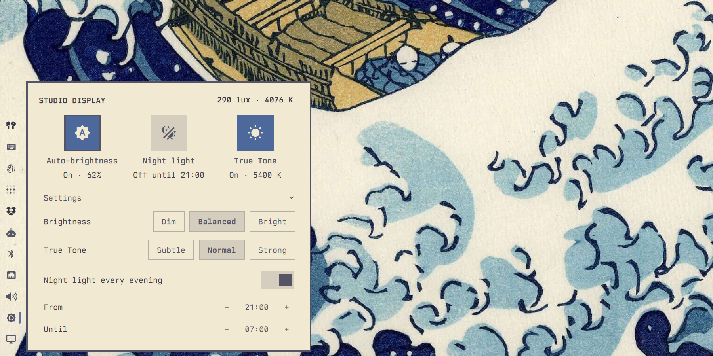

# Studio Display

Auto-brightness and True Tone for the Apple Studio Display (2022, 27") on Omarchy.



## Requirements

- An Apple Studio Display (2022, 27", USB ID `05ac:1114`) connected so its USB side reaches the computer (Thunderbolt, or USB-C with data). The plugin reads the display's own light sensor, so other displays are not supported.
- Omarchy's Apple display brightness support (`omarchy-brightness-display-apple`, which uses `asdcontrol`) and hyprsunset. Both come with Omarchy; no other dependencies. Tested on Omarchy 4.0.6.
- Node.js only to run the tests.

## Install

```sh
omarchy plugin add https://github.com/ruuts/omarchy-studio-display.git --enable --yes
```

The icon appears in the bar while the display is connected.

## Remove

```sh
omarchy plugin remove io.github.ruuts.studio-display --yes
```

Unloading hands the screen back to 6500 K (unless night light is on). hyprsunset keeps running with the schedule in `~/.config/hypr/hyprsunset.conf`, as Omarchy's own night light uses it.

## What it changes on your system

- Brightness: through Omarchy's `omarchy-brightness-display-apple`. White point: through `hyprctl hyprsunset temperature`. Night light on/off: through Omarchy's own night light (`omarchy-shell nightlight`).
- Starts hyprsunset when True Tone is on and hyprsunset isn't running.
- Edits `~/.config/hypr/hyprsunset.conf` only when you change the night light schedule (in the panel or with `setSchedule`), and then only the two schedule profiles; everything else in the file stays.
- Its settings are stored by Omarchy on the plugin's bar entry in `~/.config/omarchy/shell.json`.
- Creates Omarchy's brightness lock file in `$XDG_RUNTIME_DIR` if it doesn't exist yet, to watch it for manual changes.

## Using it

- **Auto-brightness** reads the display's ambient light sensor and sets its brightness with `omarchy-brightness-display-apple`. Choose Dim, Balanced or Bright. Changing the brightness by hand (the brightness keys, or Omarchy's monitor panel) pauses it until the room light clearly changes (2.5× brighter or darker), or until you press *Resume now*.
- **True Tone** reads the colour temperature of the room light and warms the screen's white point to match, through hyprsunset. Subtle keeps the screen at 6000 K or above; Normal goes down to 5400 K; Strong down to 4800 K.
- **Night light** keeps working: while it is on (key, menu, bar indicator or the hyprsunset schedule), True Tone steps aside; when it turns off, True Tone takes over again. In the panel the two are one or the other: clicking a waiting True Tone ends night light; switching True Tone on ends night light; clicking an active True Tone switches it off.
- **Night light schedule** in the same panel: switch night light on or off now, turn the evening schedule on or off, and set its start and end times in 30-minute steps. The schedule stays in `~/.config/hypr/hyprsunset.conf`; the panel changes its two schedule profiles and restarts hyprsunset. A switched-off schedule keeps its warm profile commented out, so its time is remembered.

Open the panel from the bar icon: three toggles (Auto-brightness, Night light, True Tone) with their state, and the finer settings folded under *Settings*. Brightness itself stays in Omarchy's Display panel and the brightness keys. Arrow keys move between the toggles and rows and change choices or times; Enter toggles or unfolds.

From a terminal or a keybinding:

```sh
omarchy-shell studio-display status
omarchy-shell studio-display toggleAutoBrightness
omarchy-shell studio-display toggleTrueTone
omarchy-shell studio-display toggleNightLight
omarchy-shell studio-display resume
omarchy-shell studio-display setSchedule true 21:00 07:00
```

## How it works

- The sensor is the iio device `als` on the display's USB HID sensor hub (`/sys/bus/iio/devices/iio:device*`), read every 2 seconds. It reports milli-lux and kelvin.
- Brightness steps up by at most 8% and down by at most 3% per reading, and ignores differences under 3%. Each step is one `asdcontrol` call.
- Manual changes are detected from Omarchy's lock file (`$XDG_RUNTIME_DIR/omarchy-brightness-display.lock`), which `omarchy-brightness-display` opens for every change, on any screen. The plugin calls the Apple script directly, so its own changes don't count, and it only pauses when the Studio Display's brightness actually changed.
- While True Tone is on, the plugin asks hyprsunset for its temperature and schedule every 2 seconds, to notice night light turning on or off. Omarchy's toggle command only turns night light on from exactly 6500 K; while True Tone holds another temperature it sets 6500 K instead, and the plugin turns that into night light (4000 K).
- Turning True Tone off sets 6500 K, Omarchy's night light "off" temperature. So does unplugging the display or unloading the plugin, so other screens don't keep its tint.
- When hyprsunset isn't running, the plugin starts it and then observes it before setting anything, so a scheduled night light that hyprsunset applies at start stays on. Schedule edits change only the two schedule profiles in `hyprsunset.conf`; other profiles, settings and comments stay. hyprsunset restarts once the file is saved.
- Settings live inline on the bar entry in `~/.config/omarchy/shell.json`.

## Known limits

- With Normal or Strong, Omarchy's night light indicator can show "on" after a shell restart while True Tone holds a temperature below 6000 K. Toggling it once fixes it. Subtle never goes below 6000 K and avoids this.
- On a fresh start the plugin treats anything below 4800 K (warmer than True Tone ever goes) as night light. If hyprsunset kept running past a schedule's identity entry, it still reports the old night light temperature, so True Tone stays paused until night light is toggled or the next schedule entry.
- Every brightness step is one call to Omarchy's `omarchy-brightness-display-apple`, which runs `asdcontrol` with elevated rights and so leaves a line in the auth log. That happens only while the brightness is moving, not while it is steady.
- Omarchy's hot reload logs "reloading" but doesn't reliably apply changes to this plugin (service, widget or `Model.js`); after changing any of its files, restart the shell (`omarchy restart shell`).
- A brightness key pressed during an automatic brightness step (one `asdcontrol` call, about 60 ms) can be undone by that step. Preventing it would mean holding Omarchy's brightness lock, which makes Omarchy drop the key press instead.
- Enabling True Tone starts hyprsunset, which also applies the schedule in `~/.config/hypr/hyprsunset.conf` (by default: night light from 21:00 to 07:00).

## Tests

```sh
node test.cjs
```
